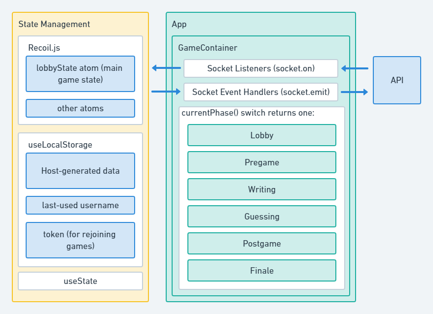

# Tricktionary

Tricktionary is a game developed by StorySquad.

This frontend application is a React/TypeScript project that relies heavily on the use of WebSockets.
We use socket.io to handle player connections and game events.

## Notable Technologies/Dependencies Used

- [yarn](https://yarnpkg.com/)
- [React](https://reactjs.org/)
- [TypeScript](https://www.typescriptlang.org/)
- [socket.io](https://socket.io/)
- [Recoil.js](https://recoiljs.org/)
- [Sass (SCSS)](https://sass-lang.com/)
- [jwt-decode](https://www.npmjs.com/package/jwt-decode)

## Application Architecture

Here is a basic layout of the application from a frontend perspective:

## Environment Variables for Developers and Deployment

For a list of required environment variables, look in [./src/utils/constants.ts](./src/utils/constants.ts)

---

---

# Getting Started

The app is built with [Vite](https://vite.dev/) and tested with [Vitest](https://vitest.dev/). It needs Node 22 or newer (`.nvmrc` pins 24) and yarn 1.

Environment variables keep their `REACT_APP_` names (set in the shell or a `.env` file). They are read through `import.meta.env` and baked into the bundle at build time.

## Available Scripts

In the project directory, you can run:

### `yarn start` (or `yarn dev`)

Runs the app in development mode on [http://localhost:3000](http://localhost:3000). The page reloads when you make edits.

### `yarn build`

Type-checks the project and builds it for production into the `build` folder (minified, hashed file names, `public/` copied in, including `_redirects`).

### `yarn preview`

Serves the production build from `build` locally.

### `yarn test`

Runs the test suites once with Vitest (jsdom and Testing Library). Use `yarn vitest` for watch mode.

### `yarn lint`

Runs ESLint (flat config in `eslint.config.mjs`: TypeScript, React, React Hooks and Prettier rules).
